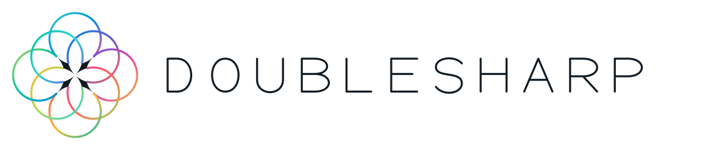

<p align="center">
  <picture>
    <source media="(prefers-color-scheme: dark)" srcset="assets/brand/doublesharp-dark.svg">
    
  </picture>
</p>

<h1 align="center">dsstack</h1>

<p align="center">15 core skills and an optional security skill for Codex and Claude, with a Python standard-library installer.</p>

<p align="center">
  <a href="#quick-start">Quick start</a> ·
  <a href="#skills">Skills</a> ·
  <a href="#private-configuration">Private configuration</a> ·
  <a href="#development">Development</a>
</p>

---

Each dsstack skill is a folder with a `SKILL.md` file, optional references, and any helper scripts it needs. Copy one folder or install the collection. Your agent selects skills by their descriptions, or you can name one in a request:

```text
Use $ds-debug to investigate this failure.
```

## Quick start

Requires Python 3.9+ and Git. Preview each operation before adding `--apply`:

```sh
# Preview and build a bundle.
python3 scripts/dsstack.py bundle --dest .local/bundles/v1
python3 scripts/dsstack.py bundle --dest .local/bundles/v1 --apply

# Preview, install, and check the links.
python3 .local/bundles/v1/scripts/dsstack.py install --dest ~/.agents/skills
python3 .local/bundles/v1/scripts/dsstack.py install --dest ~/.agents/skills --apply
python3 .local/bundles/v1/scripts/dsstack.py doctor --dest ~/.agents/skills
```

Use your host's skill directory, such as `~/.agents/skills` or `~/.claude/skills`. Start a fresh agent session after installation.

The installer creates symlinks into the bundle. Editing this checkout leaves the installed copy unchanged. If an existing skill conflicts, the installer stops before changing any links. Keep the bundle in a durable location.

## Skills

Start with `ds-work`, `ds-debug`, `ds-tdd`, and `ds-review`. Choose domain skills for the code you're changing.

| Area | Skills | What they help with |
| :--- | :--- | :--- |
| Delivery | [ds-work](skills/ds-work/SKILL.md) · [ds-plan](skills/ds-plan/SKILL.md) | Task lists, plans, blockers, and handoffs. |
| Correctness | [ds-debug](skills/ds-debug/SKILL.md) · [ds-tdd](skills/ds-tdd/SKILL.md) · [ds-review](skills/ds-review/SKILL.md) | Reproduce failures, test fixes, and review concrete defects. |
| Consultation | [ds-consult](skills/ds-consult/SKILL.md) | Get independent opinions and run a requested model council. |
| Resources | [ds-resources](skills/ds-resources/SKILL.md) | Check disk capacity and clean up task-owned output. |
| Languages & services | [ds-rust](skills/ds-rust/SKILL.md) · [ds-typescript](skills/ds-typescript/SKILL.md) · [ds-solidity](skills/ds-solidity/SKILL.md) | Rust tests, TypeScript services, and Solidity contracts. |
| Interfaces | [ds-web](skills/ds-web/SKILL.md) · [ds-native](skills/ds-native/SKILL.md) | Web layouts, interaction checks, and native app lifecycle. |
| Models & design | [ds-ai](skills/ds-ai/SKILL.md) · [ds-ux](skills/ds-ux/SKILL.md) | Test model-backed features and score UX changes. |
| Writing | [ds-write](skills/ds-write/SKILL.md) | Draft and edit prose while preserving facts and the writer's voice. |

Project instructions and the user's task control the work. Consultation requires access to the requested providers. Use `ds-ux` for a requested scoring process and `ds-web` for routine interface changes.

### Optional security skill

[ds-security](optional-skills/ds-security/SKILL.md) covers dependency vulnerability checks and patches, focused security reviews, and requested codebase audits. It is excluded from default installations. Routine maintenance uses normal project builds and tests; risky reproductions require containment appropriate to the check.

Add `--include-optional ds-security` to your usual bundle command, preserving any `--local` policy argument. For an installation using `.local/policy`, preview and apply with:

```sh
python3 scripts/dsstack.py bundle --dest .local/bundles/security-v1 --local .local/policy --include-optional ds-security
python3 scripts/dsstack.py bundle --dest .local/bundles/security-v1 --local .local/policy --include-optional ds-security --apply
```

Omit `--local` if you have no private policy. Follow [Updating an installation](#updating-an-installation) when switching from an existing bundle. The selected skill becomes part of the frozen bundle; its own `install` command needs no `--include-optional` flag. That flag selects from the source checkout's optional catalog. For direct source installation, add `--include-optional ds-security` to `install`; copying just `optional-skills/ds-security/` also works. The skill keeps its license and attribution when copied alone.

Invoke it with `Use $ds-security to check and patch vulnerable dependencies.` It does not replace the separately installed `security-audit` skill or change existing installations.

## Private configuration

Public skills live at the repository root. Keep machine settings and personal additions in ignored `.local/`:

```text
dsstack/
├── skills/                 Public, portable skill folders
├── optional-skills/        Skills selected explicitly at installation
├── scripts/                Bundle and installation tools
├── docs/                   Design, validation, and customization
└── .local/                 Private and ignored by Git
    ├── policy/             Shared rules and per-skill additions
    ├── bundles/            Stable assembled installations
    ├── tools/              Private helpers
    └── backups/            Recovery material
```

Put shared additions in `.local/policy/policy.md`, domain additions in `.local/policy/skills/<skill-name>.md`, and optional capacity settings in `.local/policy/resource-profile.json`. Then assemble them into a new private bundle:

```sh
python3 scripts/dsstack.py bundle --dest .local/bundles/personal-v1 --local .local/policy
python3 scripts/dsstack.py bundle --dest .local/bundles/personal-v1 --local .local/policy --apply
```

The bundler appends private rules to the relevant `SKILL.md` files. Use global or project instructions for rules that must apply even when no skill loads.

[Customization guide](docs/customization.md)

<a id="updating-an-installation"></a>
<details>
<summary><strong>Updating an installation</strong></summary>

Build at a new bundle path and compare it with the active bundle. Preview uninstalling the old bundle and installing the new one, then apply the switch. Uninstall removes only that bundle's owned links; retain the previous bundle for rollback.

An in-checkout bundle must be under ignored, untracked `.local/`; external destinations also work. Direct installation from source is supported for development and makes source edits live immediately.

The installer does not change global instructions, model settings, plugins, or permissions.

</details>

<details>
<summary><strong>Codex, Claude, and provider metadata</strong></summary>

`SKILL.md` holds the portable instructions. Optional `agents/openai.yaml` files supply OpenAI interface metadata; Claude reads `SKILL.md` without a matching provider YAML file. See the [OpenAI](https://developers.openai.com/codex/skills#optional-metadata) and [Claude](https://code.claude.com/docs/en/skills) documentation.

</details>

<details>
<summary><strong>Checking disk capacity</strong></summary>

```sh
python3 skills/ds-resources/scripts/preflight.py --scratch /path/to/build-volume --project app --task parser-fix --expected-gib 20
```

Preflight checks the output directory, safe task paths, and capacity. It creates nothing and does not schedule builds. A [resource profile](examples/resource-profile.json) can select the location and headroom; pass `--scratch` only when no profile selects a root. Mounting is required unless the profile explicitly allows an ordinary directory. A command-line reserve cannot lower the profile's reserve.

</details>

## Development

Read [AGENTS.md](AGENTS.md). Set `TMPDIR` to an existing task-owned output directory under the project's build policy, then run:

```sh
PYTHONDONTWRITEBYTECODE=1 python3 -m unittest discover -s tests -v
python3 scripts/dsstack.py doctor
```

The tests cover bundling, link ownership, conflicts, and resource preflight. [Decision scenarios](evals/scenarios.md) cover agent choices. See [validation](docs/validation.md) for running a comparison against the previous skill text.

---

[Design rationale](docs/focus.md) · [Sources and adaptations](docs/provenance.md) · [Source lock](upstreams.lock.json) · [License notices](licenses) · [MIT license](LICENSE)
